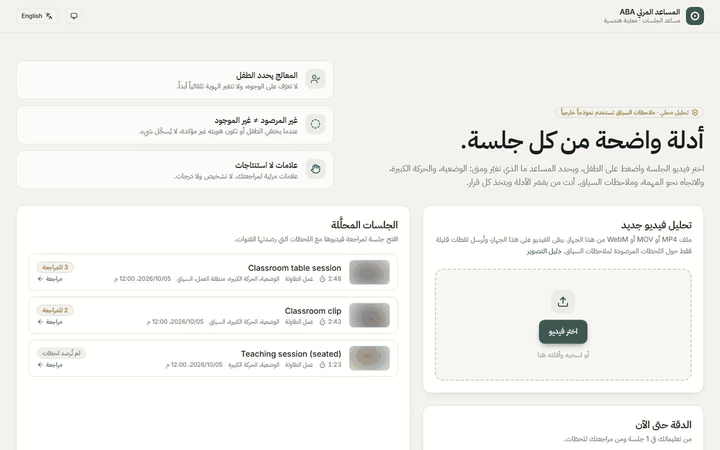
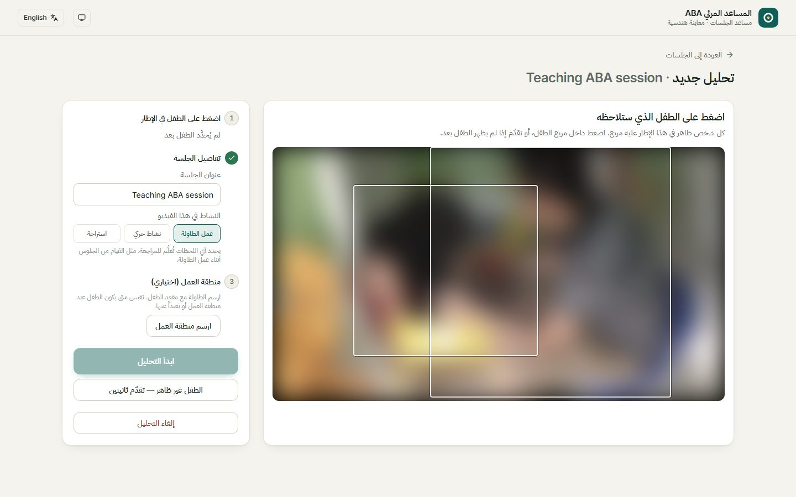
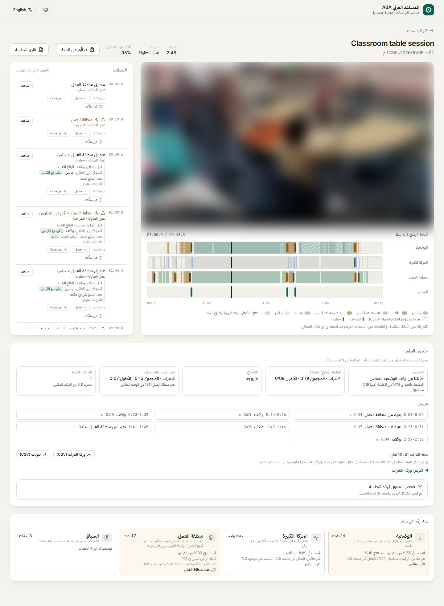
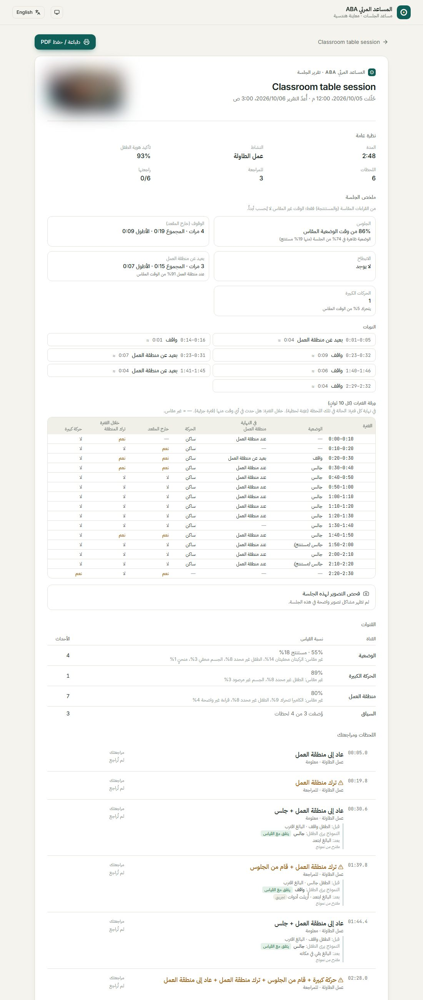
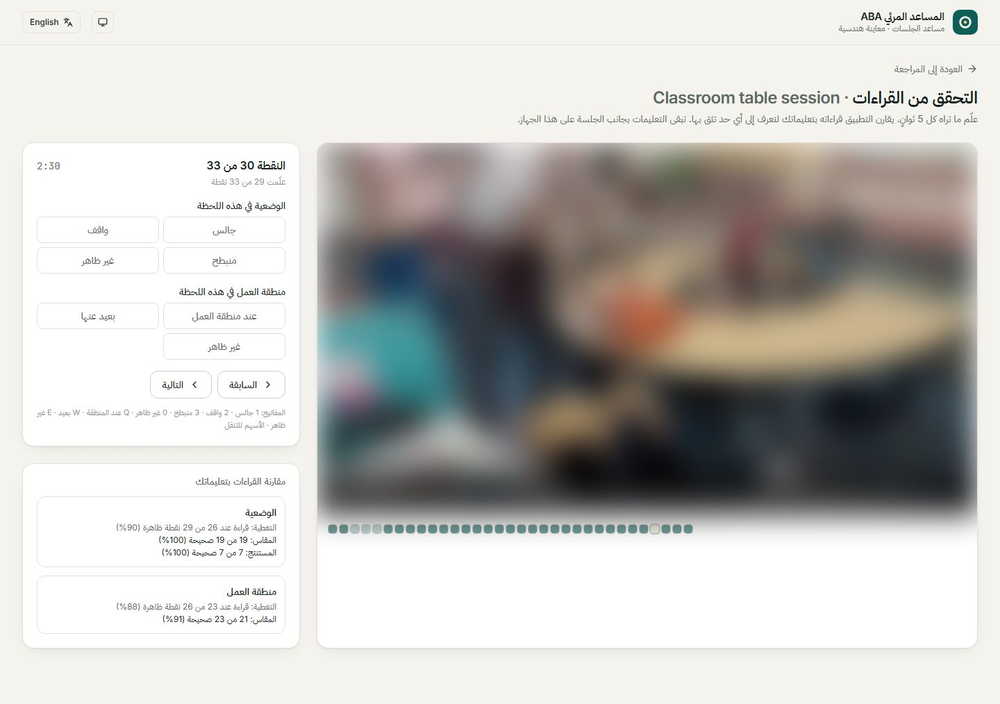
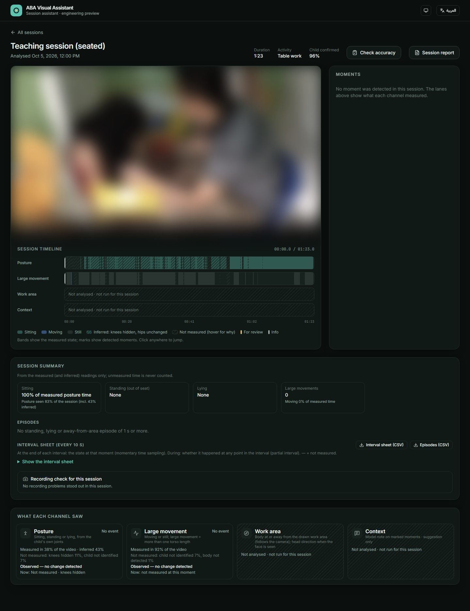

# المساعد المرئي ABA · ABA Visual Assistant

مساعد يعمل على جهاز المعالج ويساعده على مراجعة فيديو جلسة تحليل السلوك التطبيقي (ABA) المسجّلة:
يختار المعالج الطفل، فيقيس البرنامج علامات قابلة للملاحظة ويعرضها على خط زمني مع ملخص بلغة
جداول بيانات ABA. **ليس أداة تشخيص**: المعالج هو من يفسّر ويقرّر.

> هذا المستودع للعرض فقط. **الكود المصدري خاص** وغير منشور.
> English summary [below](#english).

[شاهد المقطع بجودة أعلى (MP4)](media/walkthrough.mp4) ·
*مقاطع الفيديو في كل الصور مطموسة لحماية خصوصية الأطفال.*

---

## المشكلة

مراجعة جلسة ABA مسجّلة تأخذ وقتاً طويلاً: المعالج يعيد المشاهدة ليعرف متى جلس الطفل أو قام، ومتى
ابتعد عن طاولة العمل، وكم مرة تكرر ذلك، ثم ينقل ذلك يدوياً إلى أوراق البيانات.

## الحل

البرنامج يقرأ الفيديو ويستخرج **علامات قابلة للملاحظة فقط**، ويضعها أمام المعالج مرتبطة بلحظاتها في
التسجيل، فيراجع اللحظات المهمة بدل إعادة الجلسة كاملة.

| القناة | ماذا تقيس |
|---|---|
| **الوضعية** | جالس / واقف / منبطح من مفاصل الطفل نفسه، مع تمييز ما قيس مباشرة عمّا استُنتج. |
| **الحركة الكبيرة** | متى تحرّك الطفل حركة واضحة، مع تعويض حركة الكاميرا. |
| **منطقة العمل** | هل الطفل عند الطاولة التي رسمها المعالج أم ابتعد عنها، حتى لو تحرّكت الكاميرا. |
| **السياق (اختياري)** | ملاحظة قصيرة من نموذج حول اللحظات المرصودة فقط، تُعرض اقتراحاً ولا تغيّر أي قياس. |

## رحلة المعالج

| 1. اختيار الطفل | 2. المراجعة |
|---|---|
|  |  |
| يضغط المعالج على الطفل في الإطار ويرسم منطقة العمل. لا تعرّف على الوجوه. | فيديو وخط زمني لكل قناة، وقائمة اللحظات بجانب الفيديو، ومراجعة المعالج لكل لحظة. |

| 3. تقرير الجلسة | 4. التحقق من الدقة |
|---|---|
|  |  |
| ملخص الجلسة، والنوبات، وورقة فترات كل 10 ثوانٍ، مع طباعة PDF وتصدير CSV. | يعلّم المراجع ما يراه، فيقارن البرنامج قراءاته به ويحسب التغطية والدقة. |

الواجهة بالعربية والإنجليزية، بمظهر فاتح وداكن:

## مبادئ التصميم

- **الصدق قبل التغطية**: كل وقت لم يُقس يظهر مع سببه، ولا يُحسب أبداً على أنه جلوس أو غياب للسلوك.
- **المعالج يقرّر**: البرنامج يقيس ما يُرى، ولا يحكم على الانتباه أو المشاعر أو النية.
- **الخصوصية**: التحليل يعمل على الجهاز نفسه، والفيديو لا يغادره.
- **قابلية التحقق**: كل قراءة مرتبطة بالفيديو الذي أُخذت منه، ومراجعات المعالج مرتبطة بالقراءات التي راجعها.

## الحالة

نموذج أولي يعمل، جُرّب على مقاطع جلسات منشورة. للعرض المباشر أو الاستفسار تواصل مع صاحب المستودع.

---

## English

A local assistant that helps an ABA therapist review a recorded session. The therapist selects the
child; the app measures **observable signs only** (sitting / standing / lying, large movements, being
at or away from a drawn work area, with camera motion compensated) and shows them on a timeline with
ABA-style measures: episodes, a session summary, a 10-second interval sheet, a printable report and
CSV export. Every unmeasured stretch is shown with its reason, never counted as a behaviour. An
optional model note around detected moments is shown as a suggestion only. The therapist reviews
each moment and makes every decision. **Not a diagnostic tool.**

This repository is a showcase. **The source code is private.**

---

© 2026 فريق المساعد المرئي ABA. جميع الحقوق محفوظة. All rights reserved.
لا يجوز نسخ محتوى هذا المستودع أو إعادة استخدامه دون إذن مكتوب.
